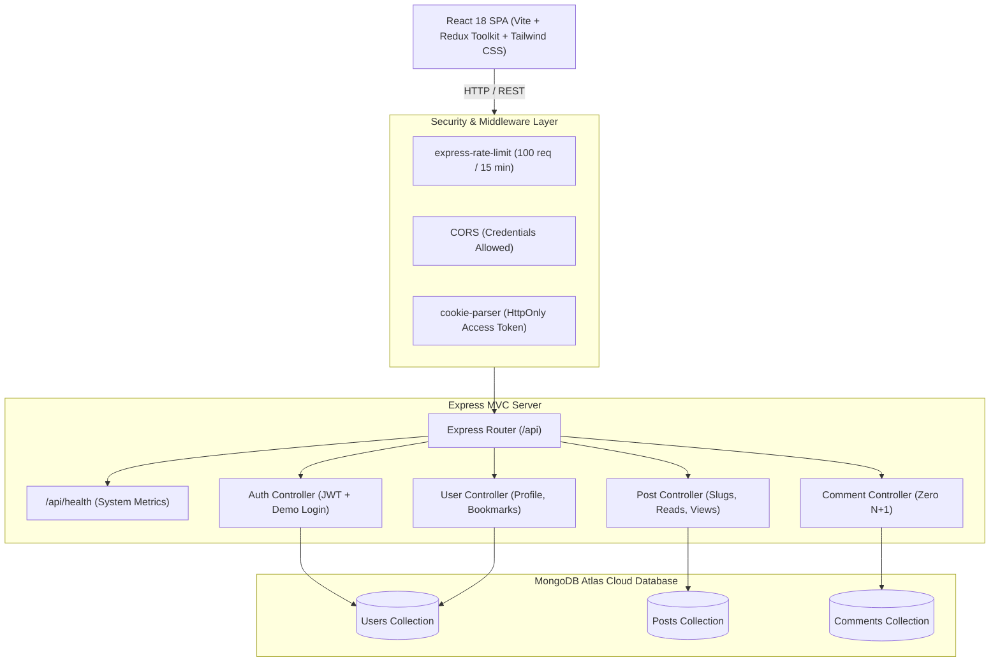

# ⚡ Personal Blog — Modern Full-Stack MERN Engineering Platform

[](https://github.com/shivangi792004)
[](https://nodejs.org)
[](https://react.dev)
[](https://www.mongodb.com)
[](https://github.com/shivangi792004)

**Personal Blog** is a production-grade, high-performance technical engineering platform architected and built by **Shivangi Singh** (B.Tech CSE '26, Lovely Professional University). Built to showcase tier-1 Software Development Engineer (SDE) principles, it incorporates clean MERN architecture, zero-N+1 query optimizations, defense-in-depth security (DOMPurify XSS scrubbing, sliding-window rate-limiting, and HttpOnly cookies), and a fluid glassmorphic UI.

---

## 🎯 Architectural Highlights & SDE Decisions

| Feature / Problem | Naive Implementation | Personal Blog SDE Implementation |
|---|---|---|
| **Query Latency (N+1 Problem)** | Client fetches user profile for every single comment individually (`useEffect` loop) | Enriched comment model with pre-populated author metadata & Mongoose batch queries, reducing N+1 roundtrips to **0**. |
| **Token Storage & XSS** | Storing JWT in `localStorage` (vulnerable to script theft) | Strict **`HttpOnly` + `SameSite` + `Secure`** cookie storage with zero JavaScript access. |
| **Client-Side HTML Injection** | Direct `dangerouslySetInnerHTML` rendering of WYSIWYG HTML | Multi-pass **`DOMPurify`** sanitization preventing stored XSS exploits. |
| **Brute-Force & DoS Mitigation** | Unrestricted endpoints open to credential-stuffing | Sliding window **`express-rate-limit`** on auth routes (100 req/15min). |
| **Slug Duplication Crashes** | Unhandled MongoDB `E11000` duplicate key errors on identical post titles | Collision-proof regex slug generator with automatic collision-counter suffix fallback. |
| **Author / Demo Friction** | Requires manual account creation and email verification | **1-Click Instant Demo Authentication** (`Demo Admin` & `Demo Author` modes). |

---

## 🏗️ System Architecture



---

## ✨ Comprehensive Feature Matrix

### 👤 Authentication & Role-Based Access Control (RBAC)
- **Granular Roles**: Administrators have platform-wide moderation rights (manage all users, comments, and metrics). Authors manage their own publications.
- **1-Click Demo Tour**: Recruiters and hiring managers can test with full admin/author privileges in 1 click without filling forms.
- **Google OAuth Integration**: Built-in Firebase federated authentication.
- **Strict Cookie Binding**: Automatic token signing, verification, and revocation on logout.

### 📰 Editorial & Publishing Engine
- **WYSIWYG Rich Text Editor**: React Quill integration with code snippets and formatted typography.
- **Dual Cover Image Ingestion**: Supports high-res Unsplash presets, direct URL pasting, and Firebase cloud uploads.
- **Reading Time Engine**: Accurate algorithm computing word count against average adult reading speeds (200 wpm).
- **Collision-Proof Slugs**: Automatic transliteration of titles into clean, SEO-friendly, unique URLs.

### ⚡ Reader Engagement & Telemetry
- **Reading Progress Bar**: Dynamic viewport progress indicator tracking scroll depth on long-form articles.
- **Real-Time View Counters**: Asynchronously tracks article readership upon page load.
- **Post Likes & Community Comments**: Instant post liking and threaded, moderated comments with like reactions.
- **Saved Articles (Bookmarks)**: Personal reading list with instant add/remove capability stored in user profile.
- **Social Sharing**: 1-click clipboard link copying with toast notification, Twitter/X, and LinkedIn share deep-links.

### 🔍 Search & Multi-Param Filtering
- **Multi-Vector Search**: Filter by keyword regex, publication category, and ascending/descending dates.
- **Pagination & Infinite Scrolling**: Controlled server-side offsets and limit parameters.

---

## 📡 REST API Reference

### Health & Telemetry
| Method | Endpoint | Access | Description |
|---|---|---|---|
| `GET` | `/api/health` | Public | System uptime, database connectivity state, and timestamp |

### Authentication (`/api/auth`)
| Method | Endpoint | Access | Description |
|---|---|---|---|
| `POST` | `/api/auth/signup` | Public | Register new user with validated email, username & password |
| `POST` | `/api/auth/signin` | Public | Authenticate user & issue HttpOnly JWT cookie |
| `POST` | `/api/auth/google` | Public | Federated Google OAuth authentication |
| `POST` | `/api/auth/demo` | Public | **1-Click Reviewer Demo Login** (`admin` or `author` role) |

### Publications (`/api/post`)
| Method | Endpoint | Access | Description |
|---|---|---|---|
| `GET` | `/api/post/getposts` | Public | Query publications by category, slug, author, searchTerm, sort |
| `POST` | `/api/post/create` | Authenticated | Create a publication with tags, cover image, and read time |
| `PUT` | `/api/post/updatepost/:postId/:userId` | Author / Admin | Update post contents, title, tags, or cover |
| `DELETE` | `/api/post/deletepost/:postId/:userId` | Author / Admin | Permanently delete publication and associated comments |
| `PUT` | `/api/post/like/:postId` | Authenticated | Toggle like/unlike on an article |
| `POST` | `/api/post/seed` | Public | Seed sample engineering articles into database |

### Users & Bookmarks (`/api/user`)
| Method | Endpoint | Access | Description |
|---|---|---|---|
| `PUT` | `/api/user/update/:userId` | Self | Update username, email, avatar, bio, or password |
| `DELETE` | `/api/user/delete/:userId` | Self / Admin | Delete account and associated sessions |
| `POST` | `/api/user/signout` | Authenticated | Invalidate and clear HttpOnly access token |
| `GET` | `/api/user/getusers` | Admin | Retrieve paginated platform users |
| `PUT` | `/api/user/bookmark/:postId` | Authenticated | Toggle article bookmark in reading list |
| `GET` | `/api/user/bookmarks/all` | Authenticated | Retrieve all bookmarked publications |

### Comments (`/api/comment`)
| Method | Endpoint | Access | Description |
|---|---|---|---|
| `POST` | `/api/comment/create` | Authenticated | Post comment with pre-attached author metadata |
| `GET` | `/api/comment/getPostComments/:postId` | Public | Fetch all comments for a post (Zero N+1 queries) |
| `PUT` | `/api/comment/likeComment/:commentId` | Authenticated | Like/unlike a comment |
| `PUT` | `/api/comment/editComment/:commentId` | Author / Admin | Edit comment text |
| `DELETE` | `/api/comment/deleteComment/:commentId` | Author / Admin | Delete comment |
| `GET` | `/api/comment/getcomments` | Admin | Moderate all platform comments |

---

## 🛠️ Local Installation & Development

### 1️⃣ Clone the Repository
```bash
git clone https://github.com/your-username/devpulse-mern-blog.git
cd devpulse-mern-blog
```

### 2️⃣ Install Dependencies
```bash
# Install root backend dependencies
npm install

# Install frontend client dependencies
cd client
npm install
cd ..
```

### 3️⃣ Configure Environment Variables
Create a `.env` file in the root directory:
```env
MONGO=mongodb+srv://<username>:<password>@cluster0.mongodb.net/devpulse?retryWrites=true&w=majority
JWT_SECRET=your_super_secret_jwt_key_here
PORT=3000
NODE_ENV=development
```

Create a `client/.env` file:
```env
VITE_FIREBASE_API_KEY=your_optional_firebase_api_key
```

### 4️⃣ Run in Development Mode
```bash
# Terminal 1: Start Express backend server (with nodemon)
npm run dev

# Terminal 2: Start Vite React client
cd client
npm run dev
```
Open [http://localhost:5173](http://localhost:5173) in your browser.

### 5️⃣ Production Build & Single-Port Serving
```bash
npm run build
npm start
```
The Express server will build the Vite bundle and serve it statically from `http://localhost:3000`.

---

## 👩‍💻 Engineer & Author
 
**Shivangi Singh**  
*Computer Science & Engineering Undergrad (B.Tech 2022–2026)*  
*Lovely Professional University, Punjab, India (CGPA: 7.8)*  
- **Role Focus**: Software Development Engineer (SDE) — Full-Stack Web Systems, Distributed Architectures, Algorithmic Engineering  
- **DSA Achievements**: 300+ LeetCode problems solved (200+ active days), 5-Star HackerRank in C++, Python & SQL  
- **Certifications**: Cisco Python Essentials 2, IBM Data Literacy, HackerRank SQL (Advanced)  
- **Email**: [shivangisingh8688@gmail.com](mailto:shivangisingh8688@gmail.com)  
- **Phone**: [+91 8688128210](tel:+918688128210)  
- **LinkedIn**: [https://linkedin.com/in/shivangisingh04/](https://linkedin.com/in/shivangisingh04/)  
- **GitHub**: [https://github.com/shivangi792004](https://github.com/shivangi792004)  

---

## 🪪 License
Distributed under the **MIT License**. Free for commercial and personal usage.
